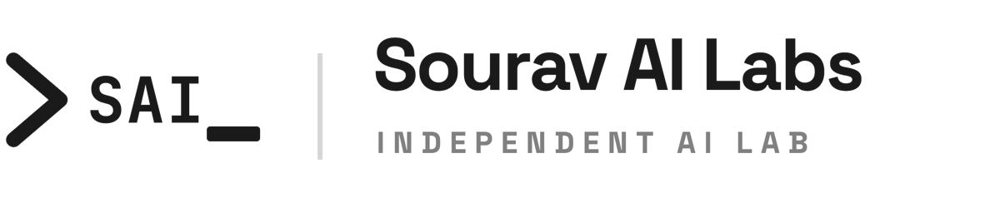
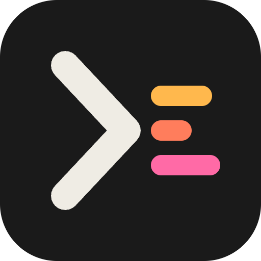

<picture>
  <source media="(prefers-color-scheme: dark)" srcset="https://raw.githubusercontent.com/srvsngh99/srvsngh99/main/assets/sai-lockup-paper.png">
  
</picture>

### Hey, I'm Sourav Singh

**Lead AI SDET · building with frontier AI every day to sharpen the part that lasts: judgement**

---

The hard part of building with AI isn't the building anymore, it's the judgement to tell what actually holds up. The tools change every week; that judgement compounds. So that's what I work on, every day, and share in the open. **[Krill](https://github.com/srvsngh99/Krill)**, **[Jugnu](https://souravailabs.ai/lab/jugnu)** (my own small decision AI model) and **[mini-krill](https://github.com/srvsngh99/mini-krill)** are the first pieces of the ecosystem I'm building.

I came up through quality engineering (10+ years, today Lead AI SDET at CRED), so the bar here is reliability, not demos. Tools, free learning, and field notes live at **[Sourav AI Labs](https://souravailabs.ai)**.

### Krill

**Ollama runs a model. Claude Code drives one. Krill does both, in one binary on your Mac.** **[Krill](https://github.com/srvsngh99/Krill)** is a Mac-native LLM engine and coding agent (Apple Silicon / MLX). ~5× faster to first token than Ollama, with ~3× less memory (≈3 GB vs 8.8 GB). Continuous batching, prefix KV-cache reuse, speculative decoding. It also serves decision models like Jugnu (`krill decide`).

 

### Jugnu: a small decision AI model

**[Jugnu](https://souravailabs.ai/lab/jugnu)** (Hindi for firefly) is my own decision model, released openly. Give it a text, a question and your options: it picks one, or answers yes or no, and tells you how sure it is. It never writes text. 149 M parameters and a 288 MB download, small enough to run on a laptop. On all 77 Banking77 intents in one call it scores 89.4, against Laya's 57.1.

The reading brain is a borrowed open-source encoder. Everything that makes it decide is my own work: the decision layer, the input format, the training and the evaluation. The weights and a small runtime are open on **[Hugging Face](https://huggingface.co/srv-sngh/jugnu-1.0)**; the training code stays private. Run it with Python or Krill: `krill pull srv-sngh/jugnu-1.0`.

 

### Featured: Mini Krill

**[Mini Krill](https://github.com/srvsngh99/mini-krill)**: a lightweight, open-source AI agent. Run it locally via Ollama or through cloud providers, free to use and build on.

Chat from Telegram, terminal CLI, TUI dashboard, or Discord, with unified memory across all interfaces. Powered by Ollama for fully private inference, with optional ChatGPT and Claude support via official CLIs. Runs seamlessly on Windows, Linux, and macOS. Single binary. ~15MB. Lightweight and clean.

Inspired by Jarvis and OpenClaw.

 

### Also

- **[Sourav AI Labs](https://souravailabs.ai)**: open-source AI tools, a free self-paced way to learn, and field notes on building with frontier AI.
- **[GenAI Testing Journey](https://github.com/srvsngh99/genai-testing-journey)**: an earlier public learning journey applying quality discipline to AI systems. An older chapter; the work now lives in the tools above.

### Connect

